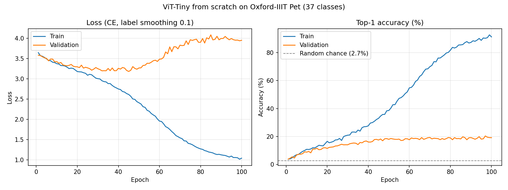

# Vision Transformer (ViT) from Scratch

A PyTorch implementation of the Vision Transformer ([Dosovitskiy et al., 2020](https://arxiv.org/abs/2010.11929)), written without any transformer or attention libraries. Multi-head self-attention, patch embedding, stochastic depth and the encoder block are all hand-written. A ViT-Tiny model was trained **from random initialization** on the Oxford-IIIT Pet dataset (37 cat and dog breeds).

> **Headline result:** best test accuracy of **20.39%** after 100 epochs (random chance is 2.7%). The model overfits heavily (92.8% train accuracy). This is expected for a ViT trained from scratch on about 3.7k images. See [RESULTS.md](RESULTS.md).



## Project structure

```
Vit_scratch/
├── notebooks/
│   └── vit_from_scratch.ipynb   # Original end-to-end notebook (Colab, T4 GPU) with all outputs
├── vit/
│   ├── model.py                 # PatchEmbedding, ViTEmbedding, MHSA, MLP, DropPath, TransformerBlock, ViT
│   └── data.py                  # Oxford-IIIT Pet transforms and DataLoaders
├── tests/
│   └── test_model.py            # Shape and sanity tests (same checks as the notebook)
├── results/
│   ├── training_log.csv         # Per-epoch loss/accuracy from the notebook run
│   └── training_curves.png      # Loss and accuracy plots
├── scripts/
│   └── plot_results.py          # Regenerates training_curves.png from the CSV
├── train.py                     # CLI training script (same recipe as the notebook)
├── predict.py                   # Top-k inference on your own images
├── RESULTS.md                   # Summary of every result
└── requirements.txt
```

## Architecture

| Component | Details |
|---|---|
| Patch embedding | `Conv2d(3, 192, kernel=16, stride=16)`: 224×224 image → 14×14 = **196 patches** |
| Tokens | Learnable `[CLS]` token + learnable positional embedding → **197 × 192** |
| Encoder | **12** pre-norm blocks: `x + DropPath(MHSA(LN(x)))`, then `x + DropPath(MLP(LN(x)))` |
| Attention | **3 heads**, head dim 64, $\text{softmax}\left(\frac{QK^T}{\sqrt{d_k}}\right)V$ with fused QKV projection |
| MLP | 192 → 768 → 192, GELU, dropout 0.1 |
| Regularization | Dropout 0.1, stochastic depth rising linearly 0 → 0.1 across depth |
| Head | LayerNorm → Linear(192, 37) on the `[CLS]` token |
| Init | Truncated normal (std 0.02) for Linear, CLS and pos-embed; LayerNorm = (1, 0) |
| **Parameters** | **5.53M** |

## Quick start

```bash
pip install -r requirements.txt

# Run unit tests (CPU, ~seconds)
pytest -q

# Train (downloads ~800MB Oxford-IIIT Pet into ./data on first run; GPU strongly recommended)
python train.py --epochs 100 --lr 1e-3

# Predict top-5 breeds for your own images
python predict.py my_cat.jpg my_dog.jpg --checkpoint best_vit_tiny.pth

# Regenerate the plot from results/training_log.csv
python scripts/plot_results.py
```

You can also open `notebooks/vit_from_scratch.ipynb` in Colab and run it end to end.

## Training setup

| Setting | Value |
|---|---|
| Dataset | Oxford-IIIT Pet: `trainval` (3,680 images) for training, `test` (3,669 images) for evaluation |
| Augmentation | RandomResizedCrop(224, scale 0.8–1.0), HorizontalFlip, ColorJitter(0.2, 0.2, 0.2), ImageNet normalization |
| Eval transform | Resize(256) → CenterCrop(224) |
| Optimizer | AdamW, lr 1e-3, weight decay 0.05 (constant LR, no warmup or schedule) |
| Loss | Cross-entropy with label smoothing 0.1 |
| Batch size | 64 (57 steps/epoch, `drop_last=True`) |
| Epochs | 100 |
| Precision | Mixed precision (AMP) + gradient clipping (max norm 1.0) |
| Hardware | Google Colab, NVIDIA T4, about 47 s/epoch (about 78 min total) |

## Results

| Metric | Value |
|---|---|
| Best test accuracy | **20.39%** (epoch 97) |
| Final test accuracy | 19.16% (epoch 100) |
| Final train accuracy | 91.31% |
| Lowest test loss | 3.1826 (epoch 45) |

The full breakdown and analysis are in **[RESULTS.md](RESULTS.md)**.

## Possible improvements

- Start from ImageNet-pretrained weights (fine-tuning a ViT typically reaches >90% on this dataset)
- Add an LR warmup and cosine decay schedule
- Use stronger augmentation and regularization (RandAugment, Mixup/CutMix, more stochastic depth)
- Use smaller patches or a convolutional stem to inject locality bias
- Stop early around epoch 45, where test loss is lowest

## References

- Dosovitskiy et al., *An Image is Worth 16x16 Words: Transformers for Image Recognition at Scale*, ICLR 2021
- Parkhi et al., *Cats and Dogs*, CVPR 2012 (Oxford-IIIT Pet dataset)
